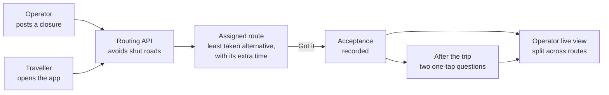

<p align="center">
  
</p>

<h1 align="center">MOD <sub>मोड</sub></h1>

<p align="center">
  Route guidance for the Tripureshwor–Koteshwor corridor in Kathmandu.<br>
  When a road closes, MOD spreads the diverted traffic instead of moving the jam.
</p>

<p align="center">
  <a href="LICENSE"></a>
  <a href="DATA.md"></a>
  
  
</p>

<p align="center">
  <a href="https://github.com/mesubash/mod">Research repository</a> ·
  <a href="#how-it-works">How it works</a> ·
  <a href="#running-it">Running it</a> ·
  <a href="docs/product.md">What it may claim</a> ·
  <a href="#status">Status</a>
</p>

When a road closes, everyone who checks a map is told to take the same
next-best road, so the jam moves there instead of clearing. MOD splits the
diverted travellers across different alternatives and tells each of them
what their route costs.

It is built on a calibrated traffic simulation of the same corridor, kept in
its own repository: [`mesubash/mod`](https://github.com/mesubash/mod). The
name is the Nepali **मोड**: a turn, a bend in the road.

## What it does

A traveller saves the trip they make most days. On a normal morning the app
says there is nothing wrong. When an operator posts a closure on that trip,
the home screen shows what happened, the route this traveller is assigned,
how much longer it takes than usual, and why it is theirs. They can accept it
or pick another option. After the trip, two one-tap questions ask whether they
took the route and whether they already knew it.

The repository has three parts:

- `api/` is the routing API, in Python and FastAPI. It holds the corridor
  road graph in memory and returns up to five distinct routes, quickest
  first, for a scooter, car, bus or truck, avoiding whatever is shut.
- `web/` is the traveller app, in React 19 and TanStack Start, built for a
  phone first. It covers onboarding, the home screen with and without a
  disruption, other options, a trip in progress with re-advice, reporting a
  problem, and the after-trip questions.
- `web/src/routes/operator/` is the operator console, for a traffic control
  desk. An operator sees the measured speed on a link before closing it,
  watches how diverted travellers split across alternatives, and reads what
  travellers report.

Vehicle class changes the answer: 488 edges in the corridor are open to a
motorcycle and not to a car.

## How it works



A closure on a traveller's usual quickest path marks the trip as diverted.
The API then assigns whichever alternative the fewest travellers on the same
trip have accepted in the last two hours, so the diversion is spread rather
than piled onto one road. Nothing is counted until the traveller accepts, and
the after-trip answers show the operator whether people took the route they
were given.

## Running it

You need [uv](https://docs.astral.sh/uv/) for the API and
[bun](https://bun.sh/) for the web app. Run each in its own terminal:

```sh
uv sync
uv run uvicorn api.main:app --reload     # http://localhost:8000
```

```sh
cd web
bun install
bun run dev                              # http://localhost:3000
```

The API allows localhost origins by default, so nothing needs configuring for
local use. To run the API in a container instead, with its database on a named volume:

```sh
docker compose up --build
```

### Configuration

| Variable | Used by | Purpose |
| --- | --- | --- |
| `MOD_OPERATOR_TOKEN` | API | Required to post or clear closures and to read reports and the split. Enter the same value in the operator console at `/operator`. |
| `MOD_CORS_ORIGINS` | API | Comma-separated allowed origins. Unset allows localhost; empty allows none. |
| `MOD_DB` | API | SQLite file path. Defaults to `data/mod.db`. |
| `BAATO_API_KEY` | API | Turns on place search through [Baato](https://baato.io/). Without it the app uses its fixed list of corridor places. |
| `VITE_API_URL` | Web | Where the browser finds the API. Defaults to `http://localhost:8000`. |

`.env.example` lists the API variables. Copy it to `.env`, fill it in, and
start the API with `uv run --env-file .env uvicorn api.main:app --reload`;
Docker Compose reads `.env` on its own.

In production, serve the web app and the API from one origin behind a reverse
proxy, for example the API under `/api/` with the prefix stripped before it
reaches the API. Build the web app with that address, since the browser
otherwise calls `localhost:8000`:

```sh
cd web
VITE_API_URL=https://mod.example.org/api bun run build
```

With one origin the browser needs no cross-origin access, so set
`MOD_CORS_ORIGINS` to empty to allow none.

### Trying the API

```sh
curl -X POST localhost:8000/route -H 'content-type: application/json' -d '{
  "origin":      {"lon": 85.3140, "lat": 27.6929},
  "destination": {"lon": 85.3495, "lat": 27.6785},
  "vehicle":     "motorcycle"
}'
```

The response lists the routes with their edges, free-flow seconds, metres and
junction coordinates. When an active closure sits on the trip it also gives
the usual time and which route this traveller is assigned. An empty list is a
real answer, not an error: a closure can leave no way through.

| Endpoint | Purpose |
| --- | --- |
| `POST /route` | Routes for one trip |
| `GET /closures`, `POST /closures`, `DELETE /closures/{id}` | What is shut; posting and clearing need the operator token |
| `POST /assignments` | A diverted traveller accepting a route |
| `POST /reports`, `GET /reports` | Traveller reports: jam, flood, closed road, accident; reading needs the operator token |
| `POST /trip-answers`, `GET /trip-answers/summary` | The two after-trip questions |
| `POST /probes`, `GET /coverage`, `GET /flow` | Position pings turned into speed per edge, how much of the network has data, and the measured speed on one edge |
| `GET /spread` | How diverted travellers have split across alternatives; needs the operator token |
| `GET /places/search` | Place search through Baato |

### Tests

```sh
uv run pytest        # API
cd web && bun test   # web helpers
```

## The research behind it

The approach comes from a calibrated SUMO microsimulation of the same
corridor, accepted at ICICSET 2026: *What Works and What Backfires: Mode
Shift, Rerouting and Departure-Time Policy on a Saturated Kathmandu
Corridor*. The study lives in its own repository,
[`mesubash/mod`](https://github.com/mesubash/mod). This repository takes one
file from it, `data/corridor-graph.json.gz`, exported from the pre-filter
corridor network build (the calibrated build drops the motorcycle-only
edges; see [`docs/graph-format.md`](docs/graph-format.md)).

What the study found:

- Diverting a share of corridor trips onto an alternative route reduces
  network delay, and the effect grows with the share: −14.4 ± 3.1% at 5%,
  −25.7 ± 3.1% at 10% and −42.6 ± 2.5% at 20%, with cordon throughput rising
  too. In the model every diverted traveller complied and took the same single
  alternative, so these are not promises about the app.
- Alternatives exist for essentially every origin–destination pair on the
  corridor.
- Moving departures earlier **raises** delay at every share tested, because
  the morning peak is a plateau rather than a spike. That is why the app has
  no rewards for leaving early.

Splitting travellers across several alternatives, rather than sending them
all to one, is MOD's own design choice. The study has no valid result for it
yet. [`docs/product.md`](docs/product.md) lists what the research supports,
what it rules out, and what is still unmeasured.

## Status

| Phase | What | State |
| --- | --- | --- |
| 1 | Router as a service | Done |
| 2 | Closures, operator console, traveller app | Done |
| 3 | Probe collection | Built; needs real travellers to answer its question |
| 4 | Live speeds in routing | Not built |
| 5 | Continuous re-advice | Working, without a saved session |
| 6 | Spreading across travellers | Working |

Routing uses free-flow times, which assume clear roads, and every screen that
shows a time says so. Phase 3 exists to find out how many active travellers
the corridor needs before measured speeds are usable; until that is known,
Phase 4 cannot start. Phases 5 and 6 were built before Phase 4, so neither has
run on live speeds. A diverted traveller is assigned whichever alternative
the fewest others on the same trip have accepted recently, and is counted only
once they accept. [`docs/phases.md`](docs/phases.md) defines what "done"
means for each phase.

## Documentation

| Read | For |
| --- | --- |
| [`docs/product.md`](docs/product.md) | What the product may and may not claim, and why |
| [`docs/phases.md`](docs/phases.md) | Build order and what "done" means for each phase |
| [`docs/architecture.md`](docs/architecture.md) | Folder layout and the decisions behind it |
| [`docs/graph-format.md`](docs/graph-format.md) | The road graph file the router reads |
| [`DATA.md`](DATA.md) | Where the road graph comes from and its licence |

Read `docs/product.md` before changing anything. Several features that look
useful are ruled out by measured results, not by taste.

The project is not taking outside contributions yet. Issues are welcome.

## Privacy

There are no accounts, and nothing stored names a person.

- The usual trip and the last five trips are kept in the browser's local
  storage on the traveller's phone. Each route request sends the trip's
  start, end and vehicle type to the API, which uses them to route and does
  not store them.
- Position pings from a trip are matched to roads inside the request. The
  sequence of positions is discarded; what is stored is a road, a speed and a
  time.
- A problem report stores its type, the exact coordinates and the time.
  Only the operator token can read reports, through `GET /reports`.
- Accepting a diverted route stores the trip's two end junction ids, the
  vehicle type, the route option number and the time. Anyone routing the
  same disrupted trip sees how many travellers accepted each option in the
  last two hours. The split across every trip, `GET /spread`, needs the
  operator token.
- After-trip answers store the two answers and the time. Sent from a trip,
  they also store the trip's two end junction ids, the vehicle type and the
  route option number.

The operator console keeps the operator token in the browser's local storage
until site data is cleared, so use it on a trusted device.

The browser also loads map tiles from [OpenFreeMap](https://openfreemap.org/)
and fonts from Google Fonts. With `BAATO_API_KEY` set, place search text is
sent to Baato.

Nothing is deleted automatically yet. The time windows in the API limit what
it returns, not what the database keeps; records stay until the database file
is cleared.

## Licence

The code is MIT ([`LICENSE`](LICENSE)). The road graph is derived from
OpenStreetMap and is under the Open Database Licence, which requires
attribution and share-alike for derived databases. See [`DATA.md`](DATA.md).

Road data © [OpenStreetMap contributors](https://www.openstreetmap.org/copyright).
